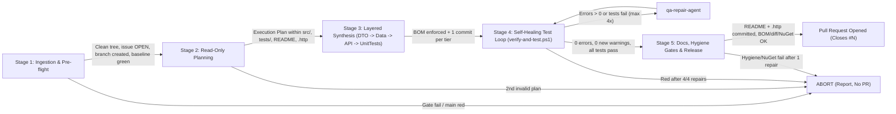

# Technical & Comparative Benchmark Report: Autonomous `/issue-to-pr` Workflow vs. Interactive GitHub Copilot

- **Repository:** `UAI-VUT-Brno/0VP-26-27Z-StudentsGroup-Team-2` (`UAI.ZeroVP` – .NET 10 ToDo REST API & Read-Only MCP Server)
- **Task:** Issue [#52](https://github.com/UAI-VUT-Brno/0VP-26-27Z-StudentsGroup-Team-2/issues/52) (`0VP-T2-26`)
- **Author:** `@Castulik` (Team 2 Leader)
- **Date:** 2026-11-20
- **Referenced Artifacts:**
  - Skill Orchestrator & Rules: [`skills/issue-to-pr/`](../skills/issue-to-pr/SKILL.md) (PR #54, PR #56, PR #60)
  - Verification Helper: [`skills/issue-to-pr/scripts/verify-and-test.ps1`](../skills/issue-to-pr/scripts/verify-and-test.ps1)
  - Transcripts: [`fr5-self-healing-verification.md`](benchmark/transcripts/fr5-self-healing-verification.md), [`e2e-issue-to-pr-run-58.md`](benchmark/transcripts/e2e-issue-to-pr-run-58.md), [`e2e-issue-to-pr-run-61.md`](benchmark/transcripts/e2e-issue-to-pr-run-61.md), [`historical-benchmark-t2-12.md`](benchmark/transcripts/historical-benchmark-t2-12.md)

---

## Executive Summary

Modern LLM-assisted coding tools accelerate local edits, yet single-session interactive chat degrades over multi-layer enterprise features: context windows saturate, architectural invariants are forgotten, breaking test sites are missed until late compilation, and IDE file-write tools silently violate repository hygiene gates (such as `.editorconfig` UTF-8 BOM rules on Windows).

To address these failure modes, Team 2 designed and verified **`/issue-to-pr`**, an unattended 5-stage multi-agent workflow implemented in `skills/issue-to-pr/` for the `UAI.ZeroVP` `.NET 10` solution (`DTO` → `Data` → `API` → `UnitTests` → `Docs`). Rather than relying on one monolithic prompt, `/issue-to-pr` isolates planning, layer-by-layer C# synthesis, compiler/test reflection, and GitHub release behind strict subagent tool boundaries and deterministic repository rules.

Across controlled verification runs and live comparative benchmarks against interactive development:
- **Zero-intervention delivery:** Unattended runs on synthetic multi-layer features ([Issue #61 → PR #62](benchmark/transcripts/e2e-issue-to-pr-run-61.md) and [Issue #58 → PR #59](benchmark/transcripts/e2e-issue-to-pr-run-58.md)) and on the historical baseline [`0VP-T2-11/12` (`9484e7e`)](benchmark/transcripts/historical-benchmark-t2-12.md) completed end-to-end with **0 human interventions** (`20 min 09 s` to PR #62, `11 min 10 s` for Stages 2–4 on `9484e7e`).
- **100% first-attempt Release test pass rate:** All three unattended feature runs achieved **0 compiler errors, 0 warnings (`CS1591`-clean), and 100% passing xUnit suites** on the first Stage 4 execution (`212/212`, `206/206`, and `143/143` respectively), requiring `0/4` repair iterations.
- **Deterministic self-healing convergence:** Under controlled fault injection ([`fr5-self-healing-verification.md`](benchmark/transcripts/fr5-self-healing-verification.md)) combining a broken Moq `Setup` (`CS1503`) and a stripped UTF-8 BOM, `verify-and-test.ps1` and `qa-repair-agent` restored full green state (`174/174`) in **1/4 attempts**.

---

## 1. System Architecture

### 1.1 Five-Stage State Machine

The `/issue-to-pr` orchestrator (`skills/issue-to-pr/SKILL.md`, 210 lines) executes one GitHub issue reference (`#<N>`, `<N>`, or full repository URL) through a linear **5-stage state machine** with explicit fail-fast gates and an `ABORT` transition that leaves no pushed branch or partial PR when a gate fails:



Key architectural properties of the state machine:
1. **Unattended execution:** Once triggered, the orchestrator never pauses for confirmation between stages; only explicit gate failures or hitting the `4/4` repair cap can halt the run.
2. **Orchestrator separation of concerns:** The orchestrator itself writes neither C# code nor Markdown documentation; it validates gates, executes `dotnet build`/`verify-and-test.ps1`, manages Explicit-Path Git commits, and passes structured stage context between stateless subagent invocations.
3. **Ephemeral stage state:** Intermediate plans, test summaries, and PR descriptions remain in conversation context or the OS temporary directory (`$env:TEMP`), never polluting the repository with temporary artifacts.

### 1.2 Multi-Agent Decomposition & Least-Privilege Tool Scopes

Each specialized subagent is defined declaratively in `skills/issue-to-pr/agents/` with YAML frontmatter serving as the **single source of truth** for its tool permissions:

| Subagent | Stage(s) | `EnableWriteTools` | Declared `tools` / `allowedCommands` | Ownership & Boundaries |
| -------- | -------- | ------------------ | ------------------------------------ | ---------------------- |
| `architect-planner` (`63 lines`) | Stage 2 | `false` | `read`, `search`, `execute` (`gh issue view`) | Reads issue JSON & live C# code; outputs structured Execution Plan (`prompts/decompose-issue.md`); cannot modify files or build `bin/`/`obj/`. |
| `csharp-developer` (`67 lines`) | Stage 3 & Stage 5 (Docs) | `true` | `read`, `search`, `edit` | Implements strictly one tier per call (`DTO`, `Data`, `API`, `UnitTests`, `Docs`) inside `src/`, `tests/`, `README.md`, `.http`; zero shell access. |
| `qa-repair-agent` (`73 lines`) | Stage 4 (& Stage 5 fallback) | `true` | `read`, `search`, `edit`, `execute` (`dotnet build`, `dotnet test`, `verify-and-test.ps1`) | Parses deduplicated compiler/test diagnostics (`prompts/compiler-test-reflection.md`); edits only failing/under-test files; cannot run `git`/`gh` or weaken tests. |
| `release-agent` (`72 lines`) | Stage 5 | `true` | `read`, `search`, `execute` (`git`, `dotnet list ... --vulnerable`, `gh pr create`, `verify-and-test.ps1 -CheckOnly -SkipTests`) | Verifies branch, diff/BOM/NuGet gates, writes PR body to OS temp file (`prompts/generate-pr.md`), pushes feature branch, opens PR; cannot edit source code or merge PRs. |

In Antigravity, the orchestrator registers these definitions once via `define_subagent` (passing the frontmatter `Name`, `Description`, `EnableWriteTools`, and Markdown body as `SystemPrompt`) and dispatches stateless invocations via `invoke_subagent`. This enforces **structural isolation**: `csharp-developer` cannot run `git commit` or bypass failing tests, `architect-planner` cannot drift into premature coding, and `release-agent` cannot silently alter failing source files to force a release.

### 1.3 Progressive Disclosure & Dual-Runtime IDE Wiring

To support both Antigravity and VS Code GitHub Copilot without duplicating workflow logic, the repository separates **discovery entry points** from the **canonical skill pack**:
- **Antigravity runtime (`.agents/skills.json`, 7 lines):** Registers the `skills` directory so Antigravity natively discovers `skills/issue-to-pr/SKILL.md` and loads subagents via `define_subagent` / `invoke_subagent` (Mode 1).
- **VS Code GitHub Copilot runtime (`.github/prompts/issue-to-pr.prompt.md`, 18 lines):** Routes `/issue-to-pr` slash commands in Copilot Agent Mode to `SKILL.md` and instructs Copilot to invoke `agent/runSubagent` (Mode 2), inlining the full agent definition, rule files, and explicit read-only guardrails (`You are read-only...`) because `runSubagent` cannot enforce `EnableWriteTools: false` at the host level.
- **Progressive disclosure:** Subagents only load the two compact rule files (`dotnet-architecture.md` at 130 lines, `git-workflow.md` at 112 lines) plus the single prompt template for their stage (`83–97 lines`), keeping every subagent context focused on the active tier.

---

## 2. Prompt Engineering & Architectural Grounding

Generic code-generation prompts frequently hallucinate non-existent helpers, break cross-layer contracts, or introduce silent bugs in stateful repositories. The `/issue-to-pr` prompt library (`skills/issue-to-pr/prompts/` + `rules/`) eliminates these failure classes through five grounding mechanisms:

### 2.1 Bottom-Up Dependency Synthesis & Compile-Time Isolation

In `rules/dotnet-architecture.md`, the solution enforces a strict acyclic reference chain:

```text
UAI.ZeroVP.DTO  <--  UAI.ZeroVP.Data  <--  UAI.ZeroVP.API  <--  UAI.ZeroVP.UnitTests
```

Stage 3 executes `csharp-developer` strictly in dependency order (`DTO` → `Data` → `API` → `UnitTests`), running `dotnet build UAI.ZeroVP.sln --configuration Release` after each tier. Because `DTO` references nothing and `Data` references only `DTO`, each upper layer compiles against **real compiled symbols** from the tier beneath it rather than guessed signatures from a single-shot prompt. Expected downstream `CS1503` errors after `Data` or `API` (e.g., un-updated test callers) are logged and passed forward rather than triggering ad-hoc edits outside the current tier.

### 2.2 Seven-Step Entity Propagation & Domain Invariants

Section 2 of `rules/dotnet-architecture.md` codifies a mandatory checklist whenever a property is added to `TodoItem`, directly preventing silent data-loss hallucinations:
1. **`TodoItem` + `TodoItem.Clone()`:** Because `InMemoryTodoRepository` stores items in a `ConcurrentDictionary<Guid, TodoItem>` and **clones on every read and write**, omitting a property from `Clone()` compiles cleanly yet drops the field to `null` at runtime. Both `csharp-layer-synthesis.md` and `compiler-test-reflection.md` highlight `Clone()` explicitly.
2. **DTO & Validation Placement:** Request DTOs (`CreateTodoItemRequest`, `UpdateTodoItemRequest`, `RepeatTodoItemRequest`) carry DataAnnotations (`[StringLength(...)]`), relying on `[ApiController]` + `AddProblemDetails()` to emit RFC 9457 `ValidationProblemDetails` automatically rather than ad-hoc `if` checks inside controllers.
3. **All Four `TodoMapper` Methods:** Explicitly forces `ToDto`, `ToEntity`, `ToEntities`, and `ApplyTo` to decide how the field is set, trimmed/normalized (`NormalizeOptional`), or cleared on `PUT`.
4. **Backward-Compatible JSON Persistence & 18-Item Seed Invariant:** New entity fields must be nullable or carry safe defaults so legacy `todos.json` files deserialize cleanly, and `InMemoryTodoRepository.Seed()` must remain at **18 items** (`SeededItemCount` and `McpServerIntegrationTests`).
5. **Deterministic Time (`TimeProvider`) & Read-Only MCP:** `DateTimeOffset.UtcNow`/`Now` is banned inside `src/` (time flows through `TimeProvider` and `nowUtc`), and `TodoMcpTools` retains `[McpServerTool(..., ReadOnly = true)]` with `[Description]` on every parameter and method.

### 2.3 Zero-Warning XML Documentation (`CS1591`) & Upfront Breaking-Site Prediction

All three `src/` projects enable `<GenerateDocumentationFile>true</GenerateDocumentationFile>`, feeding OpenAPI 3.1 / Swagger UI. Every prompt mandates English `/// <summary>`, `<example>` tags on DTOs, and `<param>`/`<response code>` tags on controller actions while leaving existing Czech comments intact.

Equally critical for C# test grounding: `UnitTests` mocks `ITodoRepository` with `MockBehavior.Strict`. Because C# Moq expression trees (`Setup(...)` / `Verify(...)`) cannot omit optional parameters (`CS0854` / `CS1503`), adding an optional parameter such as `string? project = null` to `ITodoRepository.GetAllAsync` immediately breaks every existing `GetAllAsync` call and Moq setup. Stage 2 (`prompts/decompose-issue.md` Step 6) forces `architect-planner` to `grep`/search `tests/` before coding and emit an exact `File:line` **Breaking sites** table—allowing `csharp-developer` to update all breaking call sites cleanly in the `UnitTests` tier before Stage 4 even begins.

### 2.4 Structured Self-Healing Reflection & Windows Helper Grounding

`prompts/compiler-test-reflection.md` constrains `qa-repair-agent` to an explicit **Extract → Hypothesise → Patch → Measure** loop:
- Deduplicate MSBuild errors (`CSxxxx`) and handle build failures before test assertions.
- Ground each hypothesis in the actual `git diff main...HEAD` and architectural rules; revert failed patches instead of stacking guesses across the 4-attempt ceiling.
- Never silence diagnostics (`#pragma warning disable`, `NoWarn`, `#nullable disable`, `!`, or deleting/skipping tests).

During live E2E testing in `0VP-T2-25`, Luxat added [`skills/issue-to-pr/scripts/verify-and-test.ps1`](../skills/issue-to-pr/scripts/verify-and-test.ps1) (222 lines) to close the gap between LLM file edits and Windows `.editorconfig` / SDK localization:
- Automatically detects modified/untracked `.cs` files via Git and prepends UTF-8 BOM (`EF BB BF`) before commits/tests (or fails safely under `-CheckOnly` in Stage 5).
- Runs `git diff --check` across working tree, staged changes, and `BaseRef...HEAD`.
- Executes `dotnet test UAI.ZeroVP.sln --configuration Release`, deduplicates `[A-Z]{2}\d{4}` compiler errors/warnings, extracts failing test names, and parses summary lines across both English (`Failed`/`Passed`/`Skipped`/`Total`) and Czech (`Neúspěšné`/`Úspěšné`/`Přeskočeno`/`Celkem`) .NET SDK locales using ASCII Unicode escapes (`\u00da`, `\u011b`, etc.) resilient to PowerShell 5.1 codepage issues.

---

## 3. Quantitative Benchmark Comparison

### 3.1 Benchmark Workloads & Measurement Protocol

To evaluate **Track A (Interactive GitHub Copilot in VS Code)** against **Track B (Autonomous `/issue-to-pr` Workflow)** across representative multi-layer features, we measured two primary benchmark tracks plus cross-validation runs:

1. **Workload 1 – Historical Closed Issue (`0VP-T2-11/12`, Issues [#28](https://github.com/UAI-VUT-Brno/0VP-26-27Z-StudentsGroup-Team-2/issues/28) & [#29](https://github.com/UAI-VUT-Brno/0VP-26-27Z-StudentsGroup-Team-2/issues/29)):**
   - Scope: Add optional `UserId` (`[StringLength(200)]`) across `TodoItem`, DTOs, `TodoMapper`, `ITodoRepository.GetAllAsync`, `InMemoryTodoRepository`, `GET /api/todos?userId=`, unit tests, and `.http`/docs.
   - Clean baseline: Commit `9484e7e` (`105/105` passing tests).
   - **Track A** is represented by the historical merged implementation ([PR #34](https://github.com/UAI-VUT-Brno/0VP-26-27Z-StudentsGroup-Team-2/pull/34), commit `3e9de15` by `@stepanch284`). *Measurement transparency note:* Historical Git timestamps record issue creation (`2026-10-25T21:25Z`), commit authorship (`2026-10-26T20:14:12Z`–`20:15:47Z`), PR creation (`20:16:52Z`), and merge (`2026-10-27T09:23:59Z`); exact interactive IDE keystroke and Copilot chat-prompt counts from the October session were not telemetry-logged and are therefore marked as unrecorded rather than estimated.
   - **Track B** was executed live from `9484e7e` (`bench/historical-t2-12`) with `skills/` checked out from `main` ([`historical-benchmark-t2-12.md`](benchmark/transcripts/historical-benchmark-t2-12.md)).

2. **Workload 2 – Synthetic Multi-Layer Feature ([Issue #61 → PR #62](benchmark/transcripts/e2e-issue-to-pr-run-61.md) & Cross-Validation [Issue #58 → PR #59](benchmark/transcripts/e2e-issue-to-pr-run-58.md)):**
   - Scope: Add optional `Project` tag (`Issue #61`, max 50 chars) or `Category` tag (`Issue #58`, max 50 chars) across all 5 architectural tiers including **read-only MCP `list_todos` filtering**, `McpServerIntegrationTests` `InputSchema` validation, JSON persistence backward compatibility, and Czech `README.md` / `.http` documentation.
   - Clean baseline: `main` (`174/174` passing tests).
   - Both temporary verification PRs (#62 and #59) passed local verification and GitHub Actions CI (`build-and-test`) cleanly and were closed without merging to keep `main` clean.

### 3.2 Benchmark Results by Workload

| Dimension | Workload 1 – Track A (PR #34, Historical Copilot) | Workload 1 – Track B (`/issue-to-pr` on `9484e7e`) | Workload 2 – Track B (`/issue-to-pr #61 → PR #62`) | Cross-Validation (`/issue-to-pr #58 → PR #59`) |
| --------- | ------------------------------------------------- | ------------------------------------------------- | -------------------------------------------------- | ---------------------------------------------- |
| **Baseline → Final Tests** | `105/105` → `130/130` (`+25` tests) | `105/105` → `143/143` (`+38` cases / `26` methods) | `174/174` → `212/212` (`+38` cases / `16` methods) | `174/174` → `206/206` (`+32` cases / `14` methods) |
| **Files Changed & Diff** | `13` files (`+246 / -11`) | `12` files (`539`-line new test suite + 11 edits) | `19` files (`+480 / -44`) | `18` files (`+412 / -40`) |
| **Wall-Clock Duration** | `~22 h 52 min` issue-to-PR elapsed (active IDE telemetry unrecorded; manual multi-turn edits) | `11 min 10 s` (Stages 2–4; PR push skipped for historical PR #34) | `20 min 09 s` to PR #62 (`20 min 53 s` to final report) + `53 s` CI | Full unattended 5-stage run + `43 s` CI (`build-and-test`) |
| **Human Interventions** | Full manual cycle (prompting, edits, `dotnet test`, PR creation) | `0` (unattended) | `0` (unattended) | `0` (unattended) |
| **Breaking Sites Predicted / Fixed** | 5 sites documented manually in Issue #29 brief | 5/5 predicted by planner, 5/5 fixed in `UnitTests` | 11/11 predicted by planner, 11/11 fixed in `UnitTests` | 12 predicted / 11 breaking sites fixed in `UnitTests` |
| **Stage 4 First-Attempt Result** | N/A (manual iterative build/test during dev) | `143/143` PASS (`0` errors, `0` warnings) | `212/212` PASS (`0` errors, `0` warnings) | `206/206` PASS (`0` errors, `0` warnings) |
| **Self-Healing Attempts Used** | N/A | `0/4` | `0/4` | `0/4` |
| **UTF-8 BOM Auto-Fixes** | Manual / editor-handled | `5/12` `.cs` files auto-fixed by `verify-and-test.ps1` | `7/17` `.cs` files auto-fixed by `verify-and-test.ps1` | `8` `.cs` files caught in Stage 5 (motivated Stage 3 hook) |
| **GitHub Actions CI (`build-and-test`)** | `SUCCESS` (merged `3e9de15`) | Local Release gate `PASS` (`0` errors, `0` warnings) | `SUCCESS` (`53 s`, run `44815761333`) | `SUCCESS` (`43 s`, run `44292347336`) |

### 3.3 Five-Metric Comparison Summary (Track A vs. Track B)

| Required Metric | Track A: Interactive GitHub Copilot (VS Code) | Track B: Autonomous `/issue-to-pr` Workflow | Comparative Assessment |
| --------------- | --------------------------------------------- | ------------------------------------------- | ---------------------- |
| **1. Total Time to PR** | Multi-turn human-paced cycle across planning, editing, manual test runs, and PR authoring (`~22h 52m` calendar span on #28/#29; interactive session duration unrecorded). | **`20 min 09 s`** unattended end-to-end on full 5-layer + MCP `#61 → PR #62` (`11 min 10 s` Stages 2–4 on `9484e7e`). | Predictable ~11–21 min unattended execution including full Release verification and PR creation, eliminating human context-switching overhead. |
| **2. Human Interventions** | High (continuous prompt engineering, manual file switching, manual `dotnet test` invocation, manual commit/PR writing). | **`0` interventions** across all 3 feature runs (`#58`, `#61`, `9484e7e`), after a single `/issue-to-pr #<N>` trigger. | Complete hands-off autonomy from issue ingestion through `gh pr create`. |
| **3. First-Attempt Pass Rate** | Variable: manual coordination required to prevent breaking Moq `Setup` sites (`CS0854`/`CS1503`), `Clone()` omissions, and `CS1591` warnings. | **`100%` (`3/3` feature runs green on Stage 4 attempt 1)** with `0` compiler errors and `0` warnings (`212/212`, `206/206`, `143/143`). | Bottom-up tier builds + upfront Stage 2 breaking-site search make first-attempt Stage 4 passes the norm rather than an exception. |
| **4. Self-Healing Efficiency** | Manual developer debugging loop using IDE error list and Copilot chat fixes. | **`0/4` attempts needed** on green feature runs; **`1/4` attempts** to resolve injected `CS1503` + missing-BOM fault (`174/174` green). | Bounded 4-attempt reflection (`compiler-test-reflection.md`) + `verify-and-test.ps1` recovers cleanly when errors occur without weakening assertions. |
| **5. C# Code Quality & Style** | Conforms after review, though subject to human variation (e.g., `NormalizeUserId` named specifically for one field vs. reusable helper). | **Consistent adherence** to `.NET 10` rules (`NormalizeOptional`, `Clone()`, `TimeProvider`, `MockBehavior.Strict`, `CS1591`-free XML docs, RFC 9457, `ReadOnly = true` MCP, UTF-8 BOM, NuGet scan). | Structural checklists (`csharp-layer-synthesis.md`) and automated Stage 3/5 gates produce uniform, review-ready diffs with clean tier commits. |

---

## 4. Failure Modes, Edge Cases & Model Limitations

Testing the pipeline under both fault injection and evolving codebases exposed five concrete failure modes and model limitations that shaped the final hardened system:

1. **IDE File Tools Stripping UTF-8 BOM on Windows (`.editorconfig` Violation):**
   - *Failure mode:* In the first E2E run ([`e2e-issue-to-pr-run-58.md`](benchmark/transcripts/e2e-issue-to-pr-run-58.md)), `edit_file` and `write_file` omitted the `EF BB BF` UTF-8 BOM across **8 modified/created `.cs` files**, triggering Stage 5 hygiene-gate failures (`0d06416` cleanup commit). Conversely, instructing `csharp-developer` to manually prepend `\uFEFF` inside `write_file` risked **doubling the BOM** (`TodoProjectTests.cs` observation in `#61`).
   - *Mitigation:* Wiring `verify-and-test.ps1 -SkipTests` directly into Stage 3 pre-commit eliminated manual BOM workarounds and automatically fixed `7/17` `.cs` files in `#61` and `5/12` in the `9484e7e` replay before any commit was written.

2. **Moq Expression-Tree Signatures (`CS0854` / `CS1503`) & C# Trailing Optional Parameters (`CS1737`):**
   - *Failure mode:* Because `Mock<ITodoRepository>(MockBehavior.Strict)` setups are C# expression trees, adding an optional parameter such as `string? project = null` to `ITodoRepository.GetAllAsync` breaks every existing setup/call across `TodosControllerTests.cs`, `TodoUserTasksTests.cs`, `TodoMcpToolsTests.cs`, and `InMemoryTodoRepositoryTests.cs` (`11` errors in `#61`; `5` errors in `9484e7e`). Similarly, placing `string? project = null` before `CancellationToken cancellationToken` without `= default` on `TodosController.GetAll` triggers `CS1737`.
   - *Mitigation:* Making breaking-site search a mandatory Stage 2 step (`decompose-issue.md` Step 6) enabled `architect-planner` to predict **100% of affected call sites** (`11/11` on `#61`, `5/5` on `9484e7e`) and flag `CS1737` up front, preventing Stage 4 failures altogether.

3. **Localized .NET 10 SDK Output Breaking Regex Diagnostics:**
   - *Failure mode:* On Czech Windows developer machines, `dotnet test` emits localized strings (`Nejde převést...`, `Úspěšné`, `Neúspěšné`, `Přeskočeno`, `Celkem`). Naive English-only parsers report `0/0 passed` even on green runs, while literal UTF-8 Czech strings inside `.ps1` scripts without BOM break under PowerShell 5.1's ANSI parser.
   - *Mitigation:* `verify-and-test.ps1` uses pure-ASCII `.NET` regex Unicode escapes (`\u00dasp\u011b\u0161n\u00e9`, etc.) and `[Console]::OutputEncoding = [System.Text.Encoding]::UTF8`, reliably extracting counts and deduplicating MSBuild errors across both English (GitHub Actions CI) and Czech (local Windows) environments.

4. **Rule Drift Across Historical Baselines (`9484e7e` vs. `main`):**
   - *Limitation:* Static prompt rules (`rules/dotnet-architecture.md`) encode the *current* repository invariants (18 seeded items, JSON persistence, read-only MCP tools). When replaying `/issue-to-pr` against historical commit `9484e7e` (which had 4 seeded items and no MCP server), static rules conflicted with disk state.
   - *Observation:* Because `architect-planner` enforces *"open every file before planning, never assume a signature"*, the planner detected the discrepancy, recorded it cleanly under *Open questions*, and produced an accurate plan without inventing `TodoMcpTools.cs`—confirming that **code-grounded reading must always outrank static rule assumptions**.

5. **Self-Healing Bounds, Cost & Scope Limits:**
   - *Trade-offs:* Spawning 6–7 isolated subagent turns per feature (`architect-planner` + 4× `csharp-developer` + `Docs` + `release-agent`) requires **~11–21 minutes** and substantially higher token consumption than single-line Copilot inline completions. Consequently, `/issue-to-pr` excels on well-specified, multi-layer CRUD/API/test tasks (`DTO` → `Data` → `API` → `UnitTests` → `Docs`), whereas trivial one-line fixes are faster interactively and ambiguous architectural changes still require human design before invoking Stage 1.
   - *Self-healing verification:* As verified in [`fr5-self-healing-verification.md`](benchmark/transcripts/fr5-self-healing-verification.md), `qa-repair-agent` converged in `1/4` attempts on a broken Moq `Setup` + missing BOM; however, the `4/4` hard cap and `ABORT` policy intentionally prevent runaway token loops when root causes stem from ambiguous requirements rather than compiler/contract errors.

---

## 5. Conclusions & Recommendations

The comparative benchmark demonstrates that decomposing autonomous software engineering into **scoped, single-responsibility subagents** backed by **explicit repository rules** and **deterministic build/hygiene scripts (`verify-and-test.ps1`)** bridges the reliability gap between interactive LLM chat and unattended PR delivery. On `UAI.ZeroVP`, `/issue-to-pr` achieved `0` human interventions and a `100%` first-attempt Stage 4 pass rate across every benchmarked multi-layer issue while enforcing `.editorconfig`, `CS1591`, `TimeProvider`, `Clone()`, and NuGet security standards automatically.

**Recommended next steps for production adoption:**
1. Add a cross-platform `verify-and-test.sh` companion (or PowerShell Core `pwsh` target) so macOS/Linux contributors get identical BOM/diff/diagnostic parity outside Windows.
2. Add lightweight timing/token telemetry hooks to Stage 1–5 transitions so future benchmark iterations automatically emit structured CSV/JSON metrics alongside Markdown transcripts.
3. Periodically audit `rules/dotnet-architecture.md` in PR reviews whenever repository invariants change (such as adding new MCP tools or persistence backends) to keep static rules aligned with `main`.
